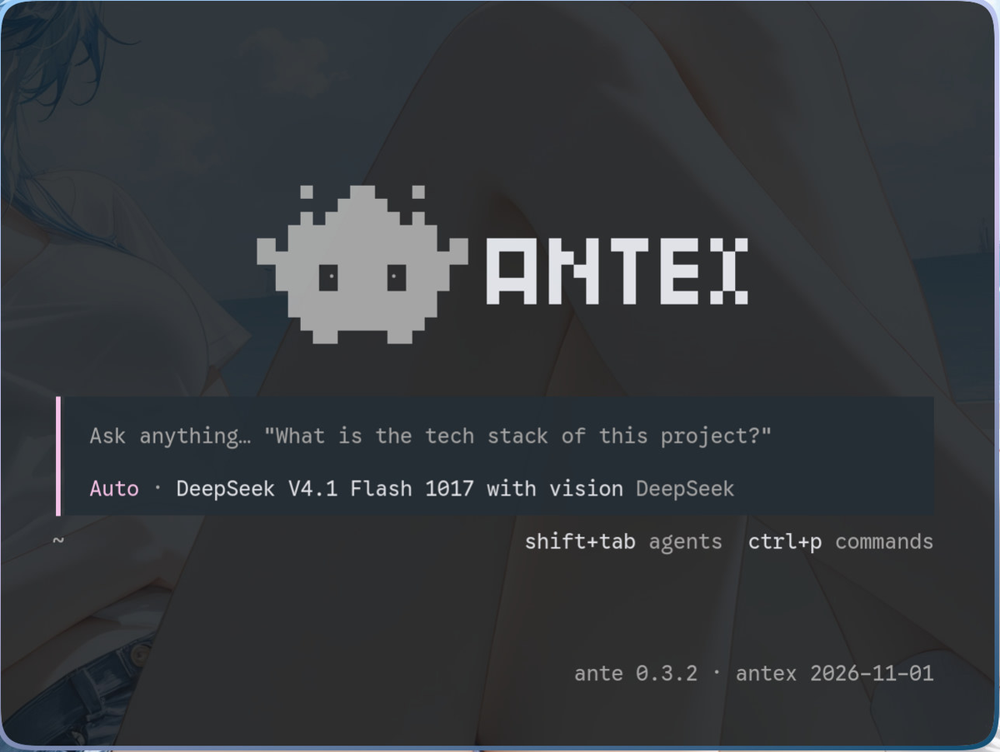

<div align="center">

# ANTEX = ANTE + OPENTUI

**Ante's agent backend, wearing OpenTUI's interface.**
**Ante 的智能体后端，穿 OpenTUI 的界面。**

Interface, theme and keybindings come from OpenTUI; every byte of data comes from Ante.
界面、主题、键位来自 OpenTUI；所有数据来自 Ante。

[](https://github.com/jianlongliu/antex/releases)
[](LICENSE)
[](#installation--安装)
[](#dependencies--依赖)
[](#dependencies--依赖)



<sub>Verified 2026-11-02 · opencode 2.2.5 (opentui 0.8.0) · Rust 1.99.1</sub>

</div>

---

## Table of contents / 目录

| English | 中文 |
| --- | --- |
| [What it is](#what-it-is) | [这是什么](#%E8%BF%99%E6%98%AF%E4%BB%80%E4%B9%88) |
| [Features](#features) | [功能](#%E5%8A%9F%E8%83%BD) |
| [Requirements](#requirements) | [环境要求](#%E7%8E%AF%E5%A2%83%E8%A6%81%E6%B1%82) |
| [Installation](#installation) | [安装](#%E5%AE%89%E8%A3%85) |
| [Usage](#usage) | [使用](#%E4%BD%BF%E7%94%A8) |
| [Updating](#updating) | [更新](#%E6%9B%B4%E6%96%B0) |
| [Uninstalling](#uninstalling) | [移除](#%E7%A7%BB%E9%99%A4) |
| [Building from source](#building-from-source) | [手动编译](#%E6%89%8B%E5%8A%A8%E7%BC%96%E8%AF%91) |
| [Dependencies](#dependencies) | [依赖](#%E4%BE%9D%E8%B5%96) |
| [Project layout](#project-layout) | [目录结构](#%E7%9B%AE%E5%BD%95%E7%BB%93%E6%9E%84) |
| [Done](#done) | [已完成](#%E5%B7%B2%E5%AE%8C%E6%88%90) |
| [Todo](#todo) | [待做](#%E5%BE%85%E5%81%9A) |
| [Abandoned](#abandoned) | [遗弃](#%E9%81%97%E5%BC%83) |
| [Troubleshooting](#troubleshooting) | [常见问题](#%E5%B8%B8%E8%A7%81%E9%97%AE%E9%A2%98) |
| [Design notes](#design-notes) | [设计取舍](#%E8%AE%BE%E8%AE%A1%E5%8F%96%E8%88%8D) |
| [Credits](#credits) | [致谢](#%E8%87%B4%E8%B0%A2) |

---

## What it is

```
OpenTUI (opencode's interface, built from this repo)   ← interface
        ↕  opencode protocol (implemented here — the "shim")
antex (this repo, one binary)
        ↕  ante-sdk / `ante serve --stdio`
Ante (installed by you: official script, `ante update`)
```

Ante is **not** vendored here and needs no special build — install yours, upgrade it as you like.
The only coupling is the protocol. If Ante changes it, the fix is usually a bump of the
`ante-sdk` version in `Cargo.toml` plus `cargo build`.

## 这是什么

```
OpenTUI（opencode 的界面，本仓库自己编的）   ← 界面
        ↕  opencode 协议（本仓库实现的「垫片」）
antex（垫片，本仓库，一个二进制）
        ↕  ante-sdk / `ante serve --stdio`
Ante（你自己装的：官方脚本装、`ante update` 升级）
```

**Ante 不在本仓库里，也不用管它**——你装你的、它更它的，垫片按它的协议趴在上面。
唯一耦合点是协议：若 Ante 升级改了协议，通常只动 `Cargo.toml` 里的 `ante-sdk` 版本 + `cargo build`。

---

## Features

Everything you see is real data translated from Ante's event stream — nothing is simulated.
Per-feature implementation notes and verification steps live in [`docs/implementation.md`](docs/implementation.md).

| Feature | Notes |
| --- | --- |
| **Real data stream** | Startup, prompt delivery, streaming text, reasoning, tool calls, approvals and failures all come from live Ante events |
| **Sessions** | List, resume, continue after resume, delete (`Ctrl+D` twice — deletes Ante's own archive directory). Opening a session **rebuilds the full transcript from its `events.jsonl`** |
| **Steering & queueing** (`Ctrl+S`) | Insert a queued message into the running turn, marked with an italic `Pending...`. Delivery is judged at Ante's real boundary — *accepted* is not *read*; the next step starting is |
| **Throughput** (`· N tok/s`) | Per-step average. The client computes `Σ(output+reasoning) ÷ Σ(streamed−created)`, and Ante never records "when the first token arrived", so both timestamps are derived by the shim |
| **Effort levels** (`/variants`, `/thinking`, `/effort`) | opencode's variant picker *is* Ante's effort. The list reports what Ante is actually running — unsupported levels are rounded down |
| **Provider sign-in** (`/connect`) | Ante's provider login translated into opencode's integration API. ChatGPT runs Codex OAuth inside the shim; Antix delegates to `ante auth login antix`; Anthropic subscription reports "not implemented" rather than pretending |
| **Model / provider list** | Fed from `ante catalog`'s merged catalog, filtered to providers that actually have credentials — the same rule Ante's own `/providers` uses |
| **Quota sidebar** (`▼ Quota`) | DeepSeek balance, Command Code 5h/W/M + balance, ChatGPT subscription windows, OpenCode Go usage. Only providers with working credentials appear; `Unavailable` is reserved for real failures |
| **Todos** (`▼ Todo`) | The sidebar list is derived from Ante's `TodoWrite` tool calls. Requires `include_tools: ["TodoWrite"]` at session start — Ante 0.3 does not offer it by default, and `SessionUpdate`/`ResumeSession` cannot add it, so **existing sessions must be reopened** |
| **Image paste** | Paste and send. Ante caps at ≈240KB base64 / ≈170KB raw; the shim compresses to ≤160KB and says so when it cannot |
| **Reconnect** | Backoff reconnect, honest `/api/health`, one transcript notice, queued messages survive the gap. Sessions whose turn was killed mid-flight are repaired (`src/repair.rs`) so you can keep talking |
| **Terminal is never held hostage** | Catchable signals are forwarded to the client, which restores raw mode. On Linux the client is bound with `PR_SET_PDEATHSIG`, so even `SIGKILL` is survivable (macOS lacks this mechanism and can still orphan) |
| **Common commands** | `/compact`, `/rename`, `/copy`, `/export`, `/stats`, `/skills` — all backed by real Ante data |
| **Interactions** | Model picker, `shift+tab` permission mode, `@` file completion, Herdr status reporting, full boot API. Multi-tab is temporarily disabled (`tabs.mode = "off"`) |
| **Undo / redo** (`/undo`, `/redo`) | Wired to `Op::RewindSession`. Ante really rewrites its own `events.jsonl` and `meta.json` — this is not a UI overlay |
| **`!` commands** | Run a shell command from the composer; output and exit code land in the transcript. Backed by `Op::ShellInput`, one request per `ShellOutput` |
| **MCP servers** (`/mcps`) | Configured in `~/.ante/settings.json` (`mcp_servers`), empty until the first prompt, and **cannot be started/stopped from the UI** — Ante has no runtime switch |
| **No fake doors** | Concepts Ante lacks (LSP, VCS, terminals, subagent sessions) are removed from the UI rather than left as dead entries |

## 功能

界面里看到的每一条都是真数据，不是模拟。逐条实现细节与验证法见 [`docs/implementation.md`](docs/implementation.md)。

| 功能 | 说明 |
| --- | --- |
| **真数据流** | 起界、提示词送达、流式文本、推理、工具调用、审批、失败可见——全由垫片喂 Ante 的真事件 |
| **会话** | 列表、恢复、恢复后继续、删除（`Ctrl+D` 两下，删的是 Ante 自己的存档目录）；**打开一条会话即从它的 `events.jsonl` 重建整份记录** |
| **插嘴与排队**（`Ctrl+S`） | 把排队消息插进正在跑的回合，带斜体 `Pending...` 角标。送到时机按 Ante 的真实边界判——**收下不算，下一个 step 开始才算模型读到** |
| **输出速率**（`· N tok/s`） | 每步行尾的均值。客户端算式是 `Σ(output+reasoning) ÷ Σ(streamed−created)`，而 Ante 从不落盘「第一个 token 何时到」，两个时刻都由垫片反推 |
| **思考档位**（`/variants`，别名 `/thinking`、`/effort`） | opencode 的档位选择器就是 Ante 的 effort。列表回报的是 Ante 实际在跑的档位——provider 支持不了会被它向下取整 |
| **供应商登录**（`/connect`） | Ante 的供应商登录翻译成 opencode 的 integration 接口。ChatGPT 由垫片自己跑 Codex OAuth；Antix 交给 `ante auth login antix`；Anthropic 订阅明确报「还没实现」 |
| **模型 / 供应商列表** | 读 `ante catalog` 的合并目录，再筛掉没凭证的——与 Ante 自己的 `/providers` 同一口径 |
| **侧栏额度面板**（`▼ Quota`） | DeepSeek 余额、Command Code 的 5h/W/M + 余额、ChatGPT 订阅窗口、OpenCode Go 用量。**配过凭据、且订阅可用**的才出现；`Unavailable` 只留给真故障 |
| **待办**（`▼ Todo`） | 数据就是 Ante 的 `TodoWrite` 工具调用。新建会话时 `StartSession.include_tools` 要 **`TodoWrite`**——Ante 0.3 默认工具集里没有它，而 `SessionUpdate`/`ResumeSession` 都带不了这个参数，**所以旧会话要重开才有** |
| **贴图** | 粘贴即发。Ante 侧硬上限 ≈240KB base64（≈170KB 原文件），垫片先压到 160KB 以内，压不下就明说 |
| **断线重连** | 退避重连 + `/api/health` 说真话 + 转录里一行说明，掉线期间排队的消息不丢。**回合没跑完就被杀掉的会话照样接着聊**（`src/repair.rs` 补 `meta.json`/`dialog.json`） |
| **终端不会被占住** | 一体化模式下垫片或客户端死掉，终端都会回到可用 shell。可捕获信号由垫片转给客户端；Linux 上另用 `PR_SET_PDEATHSIG` 兜住 `SIGKILL`（**macOS 没有这个机制，仍会留孤儿**） |
| **常用命令** | `/compact`、`/rename`、`/copy`、`/export`、`/stats`、`/skills`——全部有真接口 |
| **交互** | 模型选择、`shift+tab` 权限模式、`@` 文件补全、Herdr 状态上报、boot 接口全套。多标签**临时**关掉（`tabs.mode = "off"`） |
| **回溯**（`/undo`、`/redo`） | 接到 Ante 的 `Op::RewindSession`。**Ante 会改写自己的 `events.jsonl` 与 `meta.json`**，不是前端遮一层 |
| **`!` 命令** | composer 里 `!cmd` 直接跑 shell，输出与退出码进转录，走 `Op::ShellInput`，一个请求换一个 `ShellOutput` |
| **MCP 服务器**（`/mcps`） | 配在 `~/.ante/settings.json` 的 `mcp_servers`，**第一个提示词之前列表是空的**，面板里**不能启停**——Ante 没有运行时开关 |
| **不装样子** | Ante 没有的概念（LSP、VCS、终端、子代理会话）从界面里摘掉，而不是留个点了没反应的入口 |

---

## Requirements

| | Requirement |
| --- | --- |
| **Ante** | Installed separately — official script puts it at `~/.ante/bin/ante`; upgrade with `ante update`. `antex` refuses to start without it |
| **OS** | Arch Linux (x86_64) or macOS on Apple Silicon |
| **Terminal** | Any terminal that supports 256 colours. Image preview needs the kitty graphics protocol (Ghostty and Omarchy do) |
| **Rust** | 1.99.1 with `edition = "2024"` — **only needed to build from source** |

## 环境要求

| | 要求 |
| --- | --- |
| **Ante** | 需自行安装——官方脚本装到 `~/.ante/bin/ante`，`ante update` 升级。找不到 `ante` 时 `antex` 直接报错退出 |
| **系统** | Arch Linux（x86_64）或 macOS（Apple Silicon） |
| **终端** | 支持 256 色即可。图片预览需要 kitty 图形协议（Ghostty、Omarchy 支持） |
| **Rust** | 1.99.1，`edition = "2024"`——**只在手动编译时需要** |

---

## Installation

### Arch Linux

Download the package from [Releases](https://github.com/jianlongliu/antex/releases) and install it:

```sh
pkexec pacman -U antex-<version>-1-x86_64.pkg.tar.zst
```

This installs `antex`, `antex-tui` and `opencode2` into `/usr/bin`.

### macOS (Apple Silicon)

```sh
curl -LO https://github.com/jianlongliu/antex/releases/latest/download/antex-<version>-macos-arm64.tar.gz
tar -xzf antex-<version>-macos-arm64.tar.gz
install -m 755 antex-<version>-macos-arm64/bin/* ~/.local/bin/
xattr -c ~/.local/bin/antex          # macOS may SIGKILL a copied binary otherwise
```

`~/.local/bin` is not on `PATH` by default on macOS — either add it or call `~/.local/bin/antex` directly.

### From source

See [Building from source](#building-from-source).

## 安装

### Arch Linux

从 [Releases](https://github.com/jianlongliu/antex/releases) 取包安装：

```sh
pkexec pacman -U antex-<版本>-1-x86_64.pkg.tar.zst
```

包装到 `/usr/bin`，含 `antex`、`antex-tui`、`opencode2` 三个文件。

### macOS（Apple Silicon）

```sh
curl -LO https://github.com/jianlongliu/antex/releases/latest/download/antex-<版本>-macos-arm64.tar.gz
tar -xzf antex-<版本>-macos-arm64.tar.gz
install -m 755 antex-<版本>-macos-arm64/bin/* ~/.local/bin/
xattr -c ~/.local/bin/antex          # 不清理的话 macOS 可能直接 SIGKILL 掉拷贝过的二进制
```

macOS 默认 `PATH` 不含 `~/.local/bin`——要么加进去，要么直接写全路径 `~/.local/bin/antex`。

### 从源码

见[手动编译](#%E6%89%8B%E5%8A%A8%E7%BC%96%E8%AF%91)。

---

## Usage

Start the shim and hand the terminal to the TUI — one command, and the shim stops when the TUI exits:

```sh
antex
```

Or run them separately:

```sh
antex serve 41999                             # terminal A: shim only, stays in foreground
antex-tui --server http://127.0.0.1:41999     # terminal B: the client
```

| Flag / variable | Meaning |
| --- | --- |
| `antex PORT` | Use `PORT` instead of the default `41999` |
| `antex serve [PORT]` | Serve only; do not start the TUI |
| `antex -v` / `--version` | Print shim, backend and client versions |
| `antex -h` / `--help` | Usage |
| `ANTE_BIN` | Path to the `ante` binary (default: `$PATH`, then `~/.ante/bin/ante`) |
| `ANTEX_CLIENT` | Client to run (default: `~/.local/bin/antex-tui`, then `opencode2` → `opencode`) |

- **Multiple instances are fine.** In one-command mode a taken port is skipped and the next free one is
  printed. `serve` mode is the opposite: it uses exactly the port you gave and fails loudly if busy —
  silently switching would point your client at the wrong service.
- **Logs.** One-command mode writes `/tmp/antex.log` (`$TMPDIR/antex.log` on macOS) because stdout would
  scribble over the TUI. `serve` mode logs to stdout.
- **Startup self-check.** Without `ante` the shim exits rather than leaving a TUI that swallows messages.
  If `ante --version` and the compiled-in `ante-sdk` disagree on the *version series* (first two
  components, e.g. `0.3.x`), it warns — Ante and its SDK have never shipped in lockstep, so comparing
  full versions would warn on every launch.
- **Remote use needs a tty:** `ssh -t <host> '~/.local/bin/antex'`.

## 使用

一条命令——**起服务并直接进 TUI，退出时服务一起停**：

```sh
antex
```

想分开也行：

```sh
antex serve 41999                             # 终端 A：只起服务，留在前台
antex-tui --server http://127.0.0.1:41999     # 终端 B：客户端
```

| 参数 / 变量 | 含义 |
| --- | --- |
| `antex PORT` | 指定端口（默认 `41999`） |
| `antex serve [PORT]` | 只起服务，不进 TUI |
| `antex -v` / `--version` | 打印垫片、后端、客户端三方版本 |
| `antex -h` / `--help` | 用法 |
| `ANTE_BIN` | 指定 `ante` 可执行文件（默认 `$PATH`，再退到 `~/.ante/bin/ante`） |
| `ANTEX_CLIENT` | 指定客户端（默认 `~/.local/bin/antex-tui`，再退到 `opencode2` → `opencode`） |

- **可以多开。** 一体化模式下端口被占会**自动往后顺延**（并打印改用哪个）。`serve` 模式相反——按你给的端口，被占就明确报错，免得客户端连错服务。
- **日志。** 一体化模式写 `/tmp/antex.log`（macOS 是 `$TMPDIR/antex.log`），写 stdout 会糊在 TUI 上；`serve` 模式仍打在 stdout。
- **启动自检。** 找不到 `ante` 直接退出，不留一个「消息全石沉大海」的 TUI。`ante --version` 与编进二进制的 `ante-sdk` **不在同一版本系列**（前两段，如 `0.3.x`）才警告——Ante 与它发的 sdk 从来不同步，比全等会每次启动都误报。
- **远程使用要带 `-t`**（TUI 要 tty）：`ssh -t <主机> '~/.local/bin/antex'`。

---

## Updating

```sh
# Arch
pkexec pacman -U antex-<new-version>-1-x86_64.pkg.tar.zst

# macOS
curl -LO https://github.com/jianlongliu/antex/releases/latest/download/antex-<new-version>-macos-arm64.tar.gz
tar -xzf antex-<new-version>-macos-arm64.tar.gz
install -m 755 antex-<new-version>-macos-arm64/bin/* ~/.local/bin/
xattr -c ~/.local/bin/antex
```

An already-running `antex` keeps the old binary — **restart it** to pick up a new one.

### Release channels

Versions are always `date + same-day sequence`; the channel is the suffix:

| Version | Channel | Release flag |
| --- | --- | --- |
| `2026.11.02` | stable | latest |
| `2026.11.02rc1` | preview | prerelease |

- `2026.11.02rc1` < `2026.11.02rc2` < `2026.11.02` by Arch's `vercmp`, so upgrading from a preview to
  stable works normally. Two-digit preview numbers (`rc10`) also order correctly.
- A prerelease can never become "latest" on GitHub, so `/releases/latest` always points at stable.
- **Suffixes must be letters only.** `2026.11.02.rc.1` would be judged *newer* than `2026.11.02` because
  `vercmp` reads the dot as a new segment, and `pacman` would install a preview as an upgrade.
- Stable and preview share one `pkgver`; the tag must equal `v$pkgver` exactly (CI rejects mismatches).

## 更新

```sh
# Arch
pkexec pacman -U antex-<新版本>-1-x86_64.pkg.tar.zst

# macOS
curl -LO https://github.com/jianlongliu/antex/releases/latest/download/antex-<新版本>-macos-arm64.tar.gz
tar -xzf antex-<新版本>-macos-arm64.tar.gz
install -m 755 antex-<新版本>-macos-arm64/bin/* ~/.local/bin/
xattr -c ~/.local/bin/antex
```

**在跑的 `antex` 不会自己换二进制**——装完要重开。

### 两个通道

版本号一律是 `日期 + 当日序号`，通道由后缀区分：

| 版本号 | 通道 | Release 标记 |
| --- | --- | --- |
| `2026.11.02` | 正式 | latest |
| `2026.11.02rc1` | 预览 | prerelease |

- **升级关系天然成立**：`2026.11.02rc1` < `2026.11.02rc2` < `2026.11.02`（Arch `vercmp`），装过预览也能正常升到正式；两位数（`rc10`）同样正确。
- **正式版不会被预览顶掉**：GitHub 不允许 prerelease 成为 latest。
- **后缀只能用字母**（`rc`/`beta`/`alpha`/`pre`），**别加点**：`2026.11.02.rc.1` 会被 `vercmp` 判成比 `2026.11.02` 更新，`pacman` 就把预览当升级装上去。
- 正式与预览共用一个 `PKGBUILD` 的 `pkgver`，tag 必须逐字等于 `v$pkgver`（CI 会校验并拦下不一致的）。

---

## Uninstalling

```sh
# Arch
pkexec pacman -Rns antex

# macOS
rm -f ~/.local/bin/{antex,antex-tui,opencode2}
```

Remove the log and any leftover state if you want a clean slate:

```sh
rm -f /tmp/antex.log                 # macOS: rm -f "$TMPDIR/antex.log"
```

**Your Ante data is untouched.** Sessions live in `~/.ante/sessions`, credentials in `~/.ante/auth`,
settings in `~/.ante/settings.json` — `antex` only reads and writes them through Ante's own formats.
Delete those only if you mean to remove Ante itself.

## 移除

```sh
# Arch
pkexec pacman -Rns antex

# macOS
rm -f ~/.local/bin/{antex,antex-tui,opencode2}
```

想清干净就顺手删掉日志：

```sh
rm -f /tmp/antex.log                 # macOS: rm -f "$TMPDIR/antex.log"
```

**Ante 的数据一个没动。** 会话在 `~/.ante/sessions`、凭据在 `~/.ante/auth`、配置在 `~/.ante/settings.json`——`antex` 只是按 Ante 自己的格式读它们，不另起炉灶。除非你要卸掉 Ante 本身，否则别删这些。

---

## Building from source

### Dependencies

- Rust 1.99.1 (edition 2024)
- [Bun](https://bun.sh) 1.4.4 — only for building the client
- A C toolchain (the vendored client has native modules)

### Steps

```sh
git clone https://github.com/jianlongliu/antex.git
cd antex

# 1. Shim
cargo build --release
install -m 755 target/release/antex ~/.local/bin/antex

# 2. Client (patched opencode build, ~6 minutes)
./script/build-tui.sh
```

`script/build-tui.sh` links the build to `~/.local/bin/antex-tui`, which is what `antex` looks for by
default. The build output lands in `vendor/opencode/packages/cli/dist/cli-<os>-<arch>/bin/opencode`.

### Following upstream opencode

The client source lives in `vendor/opencode/` as a git subtree:

```sh
./script/upgrade-upstream.sh v2.2.5    # subtree pull + bun install + rebuild
```

Omit the argument to track upstream's default branch (`dev`). After a subtree pull, re-check the client
patches — they are listed in [`docs/client-patches.md`](docs/client-patches.md), and the merge conflicts
always look the same: upstream added new capability on the same lines.

## 手动编译

### 依赖

- Rust 1.99.1（edition 2024）
- [Bun](https://bun.sh) 1.4.4——只在编客户端时要用
- C 工具链（vendored 客户端带原生模块）

### 步骤

```sh
git clone https://github.com/jianlongliu/antex.git
cd antex

# 1. 垫片
cargo build --release
install -m 755 target/release/antex ~/.local/bin/antex

# 2. 客户端（打过补丁的 opencode 构建，约 6 分钟）
./script/build-tui.sh
```

`script/build-tui.sh` 会把产物软链到 `~/.local/bin/antex-tui`——那正是 `antex` 默认找的位置。产物落在
`vendor/opencode/packages/cli/dist/cli-<os>-<arch>/bin/opencode`。

### 跟上游 opencode

客户端源码以 git subtree 放在 `vendor/opencode/`：

```sh
./script/upgrade-upstream.sh v2.2.5    # 拉子树 + bun install + 重建
```

不给参数就跟上游默认分支（`dev`）。拉完要复核一遍客户端补丁——清单在
[`docs/client-patches.md`](docs/client-patches.md)，冲突形态每次都一样：**上游在同一处加了新能力**。

---

## Dependencies

### Toolchain

| Item | Version |
| --- | --- |
| rustc / cargo | **1.99.1** |
| edition | **2024** (the `let`-chain syntax needs it; reverting to 2021 will not compile) |

### Cargo crates (resolved versions from `Cargo.lock`)

| Crate | Version | Used for |
| --- | --- | --- |
| axum | 0.8.9 | HTTP routing and SSE |
| tokio | 1.53.1 | runtime |
| tokio-stream | 0.1.19 | broadcast → event stream (needs the `sync` feature) |
| serde | 1.0.229 | derive |
| serde_json | 1.0.151 | envelopes and event payloads |
| futures | 0.3.34 | stream plumbing |
| ante-sdk | 0.3.0 | the `Op`/`Evt` protocol; follows Ante's version series |
| reqwest | 0.12.28 | OAuth round-trips, quota fetching (rustls) |
| image | 0.25.10 | image compression |
| base64 | 0.22.1 | inline `data:` URLs |
| sha2 | 0.10.9 | attachment deduplication |
| chrono | 0.4.45 | RFC3339 timestamps in Ante's logs |

### External

| Item | Notes |
| --- | --- |
| Ante | **0.3.1** tested, via `ante-sdk` **0.3.0** (published on crates.io). The startup self-check compares version series |
| opencode client | **2.2.5**, vendored from upstream tag `v2.2.5`, built with `script/build-tui.sh`. The stock binary in `~/.opencode/bin` (2.0.18) is kept only as a fallback |
| Network | Direct access is enough; the `script/*.sh` helpers only set a proxy when something actually listens on `127.0.0.1:7890` |

## 依赖

### 工具链

| 项 | 版本 |
| --- | --- |
| rustc / cargo | **1.99.1** |
| edition | **2024**（`let` 链语法需要，改回 2021 会编译失败） |

### Cargo 依赖（`Cargo.lock` 实际解析值）

| 依赖 | 版本 | 用途 |
| --- | --- | --- |
| axum | 0.8.9 | HTTP 路由与 SSE |
| tokio | 1.53.1 | 运行时 |
| tokio-stream | 0.1.19 | 广播转事件流（**必须开 `sync` feature**） |
| serde | 1.0.229 | 派生 |
| serde_json | 1.0.151 | 信封与事件载荷 |
| futures | 0.3.34 | 流拼接 |
| ante-sdk | 0.3.0 | 连 Ante（`Op`/`Evt` 协议），跟着 Ante 的版本系列走 |
| reqwest | 0.12.28 | OAuth 往返、额度取数（rustls） |
| image | 0.25.10 | 贴图压缩 |
| base64 | 0.22.1 | 内联 `data:` URL 收发 |
| sha2 | 0.10.9 | 附件去重 |
| chrono | 0.4.45 | 读 Ante 日志里的 RFC3339 时间戳 |

### 外部依赖

| 项 | 说明 |
| --- | --- |
| Ante | 实测 **0.3.1**，经 `ante-sdk` **0.3.0**（crates.io 已发布）。启动自检比对版本系列 |
| opencode 客户端 | **2.2.5**，来自上游 tag `v2.2.5`，用 `script/build-tui.sh` 自编。`~/.opencode/bin` 那份官方 2.0.18 只作兜底 |
| 网络 | 直连即可；`script/*.sh` 只在 `127.0.0.1:7890` 真在监听时才设代理 |

---

## Project layout

```
src/main.rs          the shim: routes, envelopes, SSE, session/message store, event translation
src/attachments.rs   image paste: inline data: URL ↔ Ante's @path mention
src/integrations.rs  /connect: Ante provider login ↔ opencode integration API
src/quota.rs         quota sidebar fetching and layout
src/repair.rs        rebuilds meta.json/dialog.json for sessions killed mid-turn
src/terminal.rs      raw-mode capture, signal forwarding, parent-death signal
build.rs             bakes the compiled-in ante-sdk version into the binary
script/              build-tui.sh · upgrade-upstream.sh · shot-home.py · tui_drive.py
vendor/opencode/     upstream opencode as a git subtree — the thing being patched
docs/                implementation notes (see below)
```

Documentation is split by subject:

| File | Contents |
| --- | --- |
| [`docs/implementation.md`](docs/implementation.md) | Implementation checklist (each item measured) · approval flow · debug switches · release history |
| [`docs/pitfalls.md`](docs/pitfalls.md) | Honest list of traps · v2 API conventions and event names · Herdr integration · authoritative sources |
| [`docs/client-patches.md`](docs/client-patches.md) | Every client patch · what was removed from the UI and why · following upstream |

## 目录结构

```
src/main.rs          垫片本体：路由、信封、SSE、会话/消息存储、事件翻译
src/attachments.rs   贴图：内联 data: URL ↔ Ante 的 @path 提及
src/integrations.rs  /connect：供应商登录 ↔ opencode integration 接口
src/quota.rs         侧栏额度面板的取数与排版
src/repair.rs        回合被杀的会话，补 meta.json/dialog.json
src/terminal.rs      raw mode 存取、信号转发、父进程死亡信号
build.rs             把编译用的 ante-sdk 版本写进二进制
script/              build-tui.sh · upgrade-upstream.sh · shot-home.py · tui_drive.py
vendor/opencode/     上游 opencode（git subtree）——魔改对象
docs/                细节分册（见下表）
```

细节按主题分册：

| 文件 | 内容 |
| --- | --- |
| [`docs/implementation.md`](docs/implementation.md) | 实现清单（逐条实测）· 审批 · 排错开关 · 发版记录 |
| [`docs/pitfalls.md`](docs/pitfalls.md) | 关键坑 · v2 API 约定与事件名 · Herdr 集成 · 权威出处 |
| [`docs/client-patches.md`](docs/client-patches.md) | 客户端补丁清单 · 屏蔽做不了的入口 · 跟上游的步骤 |

---

## Done

Implemented and measured. Details in [`docs/implementation.md`](docs/implementation.md).

Real data stream · sessions (list/resume/continue/delete/transcript rebuild) · steering and queueing ·
throughput · effort levels · `/connect` · model and provider lists · quota sidebar · todos · image paste ·
reconnect and session repair · terminal restoration · `/compact` `/rename` `/copy` `/export` `/stats`
`/skills` · undo/redo · `!` commands · MCP servers · model picker · `shift+tab` permission modes ·
`@` file completion · Herdr status reporting · startup self-check · dual-platform packaging.

## 已完成

已实现并实测，细节见 [`docs/implementation.md`](docs/implementation.md)。

真数据流 · 会话（列表/恢复/继续/删除/转录重建）· 插嘴与排队 · 输出速率 · 思考档位 · `/connect` ·
模型与供应商列表 · 侧栏额度面板 · 待办 · 贴图 · 断线重连与会话修复 · 终端还原 ·
`/compact` `/rename` `/copy` `/export` `/stats` `/skills` · 回溯 · `!` 命令 · MCP 服务器 ·
模型选择 · `shift+tab` 权限模式 · `@` 文件补全 · Herdr 状态上报 · 启动自检 · 双平台打包。

---

## Todo

Reachable but not built yet.

- **In-session `/cd`** — Ante fixes a session's directory at `SessionRequest.cwd`; `SessionUpdate` has no
  field for it. The shim answers `400` with an explanation and the TUI shows it as a toast. `/cd` before
  a session exists is pure client behaviour and works normally. The fallback — reopening a session in a
  new directory — loses history and adds a row to the session list.
- **`/fork`** — Ante already has `Op::ForkSession` / `Evt::SessionForked` (plus `SessionInfo.forked_from`).
  The client calls `POST /api/session/{id}/fork` with a `before` boundary, which maps onto the op's `at`.
  The forked session does not auto-start, and the UI has to navigate to it.
- **Real session tabs** — the blocker is upstream: it needs the server to drive several sessions at once
  while the shim holds a single Ante connection. Verify Ante can do that before touching the shim.

## 待做

做得到、还没做。

- **会话内 `/cd`** —— Ante 的目录在建会话时由 `SessionRequest.cwd` 定死，`SessionUpdate` 里没有这个字段。垫片回 `400` + 说明，TUI 原样弹在 toast 里；**没开会话时**的 `/cd` 是纯客户端行为，照常可用。退一步的「按新目录重开会话」会丢历史、会话列表多一行。
- **`/fork`** —— Ante 已有 `Op::ForkSession` / `Evt::SessionForked`（附带 `SessionInfo.forked_from`）。客户端走 `POST /api/session/{id}/fork`（`before` ＝ 从哪条输入切），对应 op 的 `at`；fork 出来的是**新会话、不自动开始**，界面要跳到它。
- **真多标签** —— 卡在上游：要服务端同时驱动多条会话，而垫片只有一条 Ante 连接。先验证 Ante 侧能否并发驱动，再谈垫片改造。

---

## Abandoned

Ante has no such concept, and no amount of shim code will invent one. These were removed from the UI
rather than left as dead entries.

| Removed | Why |
| --- | --- |
| `/share`, `/unshare` | No cloud sharing; the client itself reports "not implemented for V2 sessions" |
| `/status` | No session status API |
| `/pair` | No device pairing (`/api/pair` answers empty). `/connect` is **not** in this list — it works |
| `/diff`, `/worktrees` | No diff / VCS / worktree concept. `/api/vcs` answers an empty branch so the location label does not show a fake `:main` |
| `/terminal`, Terminals panel | No PTY. `Bash` is a tool call and `!cmd` is fire-and-forget — neither is a terminal |
| `/plugins`, `/btw` | No opencode plugin system; `/btw` needs an independent generate op |
| `/reload`, `/update`, `/restart`, `Ctrl+B` backgrounding | Reloading server config, updating opencode, or backgrounding tool calls mean nothing to Ante |
| LSP, formatter | No counterpart; entries removed |
| **Subagent pane / drilling into a subagent** | The client's entire subagent UI hangs off "a subagent is a child session" (`session.parentID` + its own event stream). In Ante a subagent is one `Agent` tool call inside the parent turn, and its internals are never pushed to the frontend. Measured 2026-11-02: `ToolUpdate` appears **zero** times across all recorded sessions, and during `Agent` calls Ante emits only `UsageUpdate`. Rendering the `Agent` call as the client's subagent block is done; drilling in would need upstream to send data it does not send |

## 遗弃

Ante 底层没这个概念，写多少垫片代码也变不出来。这些是从界面里**摘掉**的，不是留个点了没反应的入口。

| 摘掉 | 原因 |
| --- | --- |
| `/share`、`/unshare` | 无云端分享；客户端自己也报 "not implemented for V2 sessions" |
| `/status` | 无会话状态接口 |
| `/pair` | 无设备配对（`/api/pair` 只答空）。**`/connect` 不在此列**——它能用 |
| `/diff`、`/worktrees` | 无 diff / VCS / worktree 概念。`/api/vcs` 答空分支，位置标签才不会挂上假 `:main` |
| `/terminal`、Terminals 面板 | 无 PTY。`Bash` 是工具调用、`!cmd` 是跑完即止，都不是终端 |
| `/plugins`、`/btw` | 无 opencode 插件系统；`/btw` 要的是独立 generate op |
| `/reload`、`/update`、`/restart`、`Ctrl+B` 后台化 | 重新加载配置 / 更新 opencode / 把工具调用扔后台，对 Ante 都无意义 |
| LSP、formatter | 无对应概念，入口已摘 |
| **子代理面板 / 点进子代理** | 客户端的子代理 UI **整套挂在「子代理 = 独立 child session」上**（`session.parentID` + 自己的事件流）。Ante 里子代理只是父回合中的一次 `Agent` 工具调用，**内部活动不推给前端**。2026-11-02 实测：全部历史会话 `ToolUpdate` 共 **0 条**，`Agent` 调用期间只发 `UsageUpdate`。按 subagent 块渲染 `Agent` 调用已做；点进去得等上游送它现在不送的数据 |

---

## Troubleshooting

**The UI is up but messages go nowhere.**
Check `/tmp/antex.log` (`$TMPDIR/antex.log` on macOS). The startup self-check line states whether `ante`
was found and whether the version series matches, e.g.
`自检：… → ante 0.3.1；antex 编译于 ante-sdk 0.3.0，同一版本系列`. Runtime failures — not connected,
event stream ended, message dropped — are written there too; nothing fails silently.

**The model list takes a few seconds.**
The shim runs `ante catalog` per request (uncached), and the TUI fires three of them at startup. `ante
catalog` waits on its OpenTelemetry export before exiting, so a slow network costs those seconds
(`ante --version`, same binary, returns in milliseconds). Disable telemetry to make it disappear:

```sh
export ANTE_TELEMETRY=off      # off / false / 0 / disable / disabled, case-insensitive
```

This only stops OTLP export; Ante's local logs in `~/.ante/logs` are unaffected.

**A pasted image is not visible to the model.**
Ante drops anything above ≈240KB base64 (≈170KB raw) — the shim compresses to ≤160KB first and says so
when it cannot. If the model reports `no vision support`, that is unrelated: the catalog entry lacks
`support_vision: true`.

**The quota sidebar shows `Unavailable`.**
Panel text is English, matching the TUI. Which providers appear is decided by credentials — no
credentials, no row; credentials present but the subscription unusable (401/403) also hides the row.
`Unavailable` is reserved for genuine failures (network, timeout, unparseable response) so a broken API
is visible instead of looking like a missing subscription.

**Can I install an opencode plugin to add features?**
No — the shim does not run JavaScript. A plugin's data half lives in opencode's own server process. To
add UI you either patch the vendored client (built-in plugins) or have the shim serve the data directly.

**Nothing changed after installing.**
A running `antex` keeps its old binary; restart it. If you changed client sources under
`vendor/opencode/`, run `script/build-tui.sh` — otherwise the old client is still in use.

**Starting under Windows Terminal over SSH put junk in the composer** (`:ffff/ffff/ffff:eeee/ffff/ffff`).
Known and upstream. Windows Terminal answers the `OSC 10/11` colour queries
(`\x1b]10;rgb:ffff/ffff/ffff\x07`), and opentui's terminal parser consumes part of that reply across an
SSH packet boundary, leaving the tail in the input stream. Omarchy and local PTYs are unaffected;
opentui 0.8.0 and 0.8.1 share identical code here.

## 常见问题

**界面在跑，发消息却没反应？**
先看 `/tmp/antex.log`（macOS 是 `$TMPDIR/antex.log`）。启动自检那行会明说 `ante` 找没找到、版本是否同一系列，例如
`自检：… → ante 0.3.1；antex 编译于 ante-sdk 0.3.0，同一版本系列`。运行期的「未连接 / 事件流结束 / 消息被丢弃」也写同一处，不会静默。

**启动后模型列表要等几秒？**
垫片每个请求都 spawn 一个 `ante catalog`（不缓存），TUI 起来时会并发拉三个。而 `ante catalog` 进程退出前要刷
OpenTelemetry 指标，网络一慢就是那几秒（同一二进制的 `ante --version` 只要几毫秒，可作对照）。关掉遥测即可：

```sh
export ANTE_TELEMETRY=off      # 取值 off / false / 0 / disable / disabled，大小写不敏感
```

只停 OTLP 导出，Ante 自己的本地日志（`~/.ante/logs`）与功能都不受影响。

**贴的图模型说看不到？**
Ante 侧硬上限：约 240KB base64（≈170KB 原文件）以上直接丢弃。垫片先压到 160KB 以内，压不下会明说。模型报
`no vision support` 是另一回事——catalog 里那个模型缺 `support_vision: true`。

**侧栏额度显示 `Unavailable`？**
面板文案是英文，跟 TUI 走。哪几家出现由凭据决定——没凭据不显示；凭据在但订阅用不了（401/403）也不显示。
`Unavailable` 只留给**真故障**（断网、超时、响应看不懂），接口坏了要能看见，不能看着像「这家没了」。

**想装个 opencode 插件加功能？**
不行——垫片**不跑 JS**，插件的取数半边在 opencode 自己的 server 进程里。要加界面只有两条路：改自编客户端（内置插件），或让垫片直接喂数据。

**装完没生效 / 改了界面没变化？**
在跑的进程不会自己换二进制，装完要重开 `antex`。改的是 `vendor/opencode/` 里的客户端源码时，还要先
`script/build-tui.sh` 重建。

**Windows Terminal 走 SSH 启动后输入框有脏字符**（`:ffff/ffff/ffff:eeee/ffff/ffff`）。
已知问题，属上游。Windows Terminal 会回 `OSC 10/11` 颜色查询（`\x1b]10;rgb:ffff/ffff/ffff\x07`），opentui 的终端解析器在跨 SSH 包边界时把这条回复吃掉一半，残尾漏进输入流。Omarchy 与本地 PTY 不受影响；opentui 0.8.0 与 0.8.1 这块代码完全相同。

---

## Design notes

Hand-reimplementing opencode's TUI would never reach its completion — its interface layer alone is about
17k lines. Doing it the other way round makes the shim a **disposable** layer: when upstream ships a new
UI, pull it and fix the shim. The cost is that concepts Ante lacks must be stubbed out.

A few settled decisions:

- **The shim is Rust.** It is a long-running process; it needs to be steady and ship as one binary.
- **Upstream lives in this repo** (`vendor/opencode/`, a git subtree tracking upstream): upgrading is
  pulling upstream, which is really just applying patches.
- **Shim only, no forked UI.** Day-to-day use does not depend on a self-built frontend (source mode needs
  3.1G of `node_modules`); forking is only necessary when changing the interface itself.
- **Mapping principle.** Only map what Ante genuinely has (`shift+tab` → permission mode, model picker →
  provider/model). What it lacks (LSP, formatter, VCS) is stubbed as empty rather than faked.

## 设计取舍

手写复刻 opencode 的 TUI 到不了它的完成度——光界面层就约 17k 行。反过来做，垫片是**可丢弃**的一层：
上游界面升级时重新拉 TUI 即可，只需跟着修垫片。代价是 Ante 没有的概念必须打桩。

几条定下来的选择：

- **Rust 写垫片**：它是长驻进程，要稳、要单文件产物。
- **上游进同一个仓**（`vendor/opencode/`，git subtree 跟主线）：升级即拉上游，本质就是打补丁。
- **只做垫片、不 fork 界面**：日常使用不必依赖自建前端（源码模式要 3.1G `node_modules`），只有要改界面本身才必须 fork。
- **映射原则**：Ante 真有对应概念的才做成真差别（`shift+tab` → 权限模式、模型选择 → provider/model）；没有的（LSP/formatter/VCS）打桩显示为空，不假装。

---

## Credits

**The TUI, keybinding system, rendering, plugin mechanism — and the very idea of driving an existing
client through a server API** — all come from **[opencode](https://github.com/sst/opencode)**. This repo
only vendors it as a git subtree and patches the "client talks to backend" layer to speak Ante. If
upstream stops shipping, this stops with it. Thanks to the opencode authors and every contributor.

**The backend** is **[Ante](https://github.com/AntigmaLabs/ante)**. The shim is a translator on top of it;
all the actual work is Ante's.

Licensed under MIT, same as upstream — see [`LICENSE`](LICENSE).

## 致谢

**TUI、键位系统、渲染、插件机制，连「用服务端 API 驱动一个现成客户端」这条路子本身**，全部来自
**[opencode](https://github.com/sst/opencode)**。本仓库只是把它 git subtree 收进来，在「TUI 调后端」那一层打几个补丁接到 Ante 上。上游不再更新，这里也就跟着停。感谢 opencode 的作者和所有贡献者。

**后端**是 **[Ante](https://github.com/AntigmaLabs/ante)**。垫片只是它上面的一层翻译，真正的活都是 Ante 干的。

许可跟上游一致（MIT，见 [`LICENSE`](LICENSE)）——随意分发修改。

<div align="center"><sub>Powered by Deepseek</sub></div>
